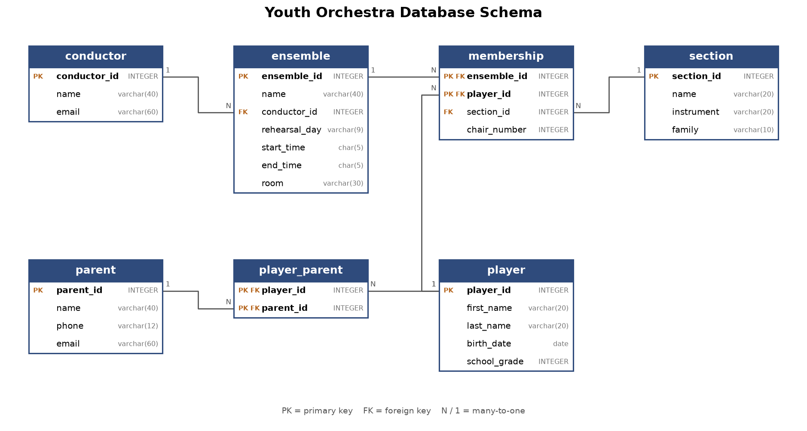

# Youth Orchestra

My project models a paid youth music program: its ensembles (symphony, wind ensemble, string quartet, ...), the conductor of each one, the players and their parents, and which section and chair each player sits in for each ensemble.

## How to run

1. `python -m venv .venv` and `.venv\Scripts\pip install -r requirements.txt`
2. Copy `config.example.json` to `config.json` and paste in your own OpenAI API key.
3. `python chat.py` to ask questions interactively, or `python run_experiments.py` to run every question under all three prompting strategies (logs are written to `responses/`).

## Files

- `setup.sql` / `setupData.sql`: the tables and the mock data.
- `db.py`: builds `aidb.sqlite` and runs read-only queries.
- `ai.py`: the prompting strategies and the OpenAI calls.
- `prompt_examples.py`: the example question/SQL pairs for the few-shot strategies.
- `chat.py`: the interactive app.
- `run_experiments.py`: the batch run over all questions and strategies.
- `make_schema_picture.py`: draws `schema.png` from the database.
